# BioField Notes 

**BioField Notes** is a mobile-ready, offline-capable field journal web application designed specifically for biology students. It allows students to document specimen observations in the field, attach photos, categorize organisms, and manage saved or deleted records.

 

## App Features

| Login Screen | Field Observation Workspace | Field Notes Drawer |
| :---: | :---: | :---: |
| 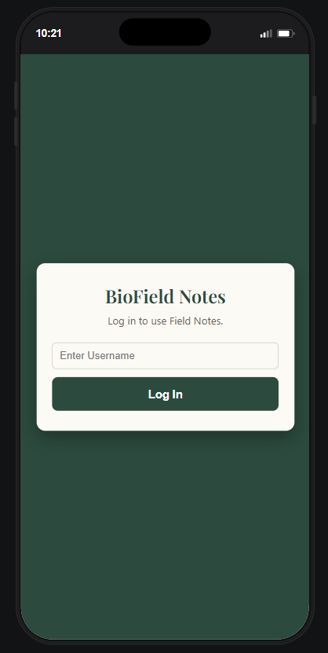 | 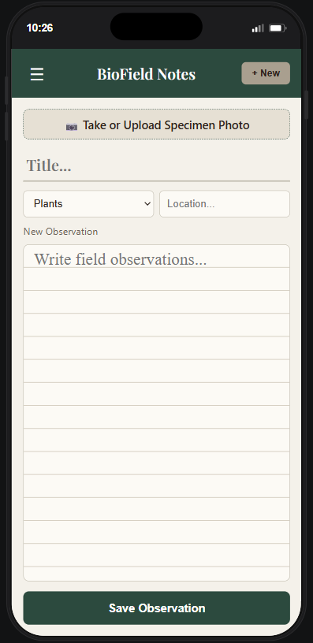 | 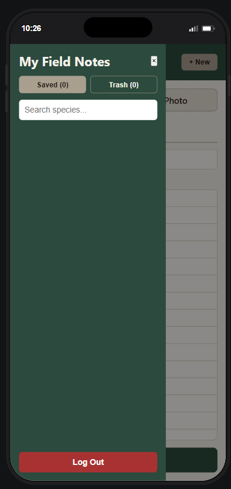 |

 ## Student Login & Logout

| Log In | Log Out |
| :---: | :---: |
| 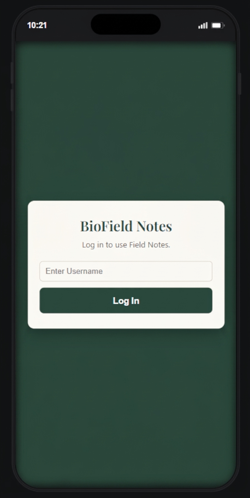 |  |

## Title & + New Observation

| Title | + New |
| :---: | :---: |
| 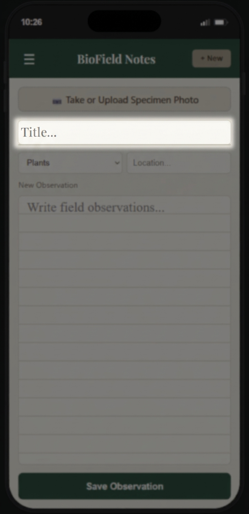 | 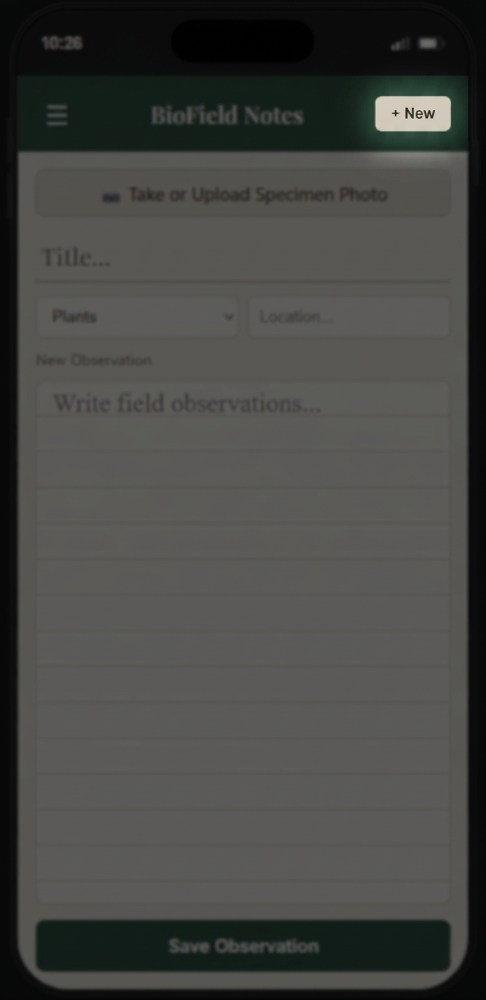

## Observation Entry

| Observation Categories | Location | Write Observation | Save Observation |
| :---: | :---: | :---: | :---: |
| 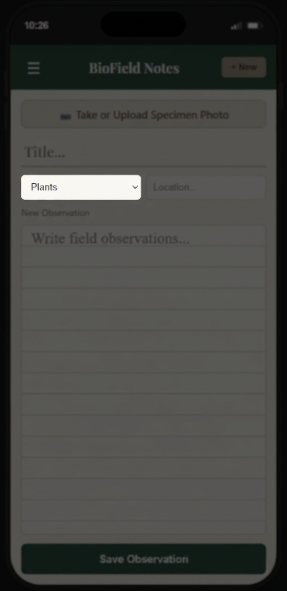 |  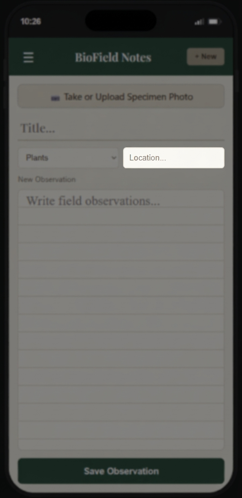 |  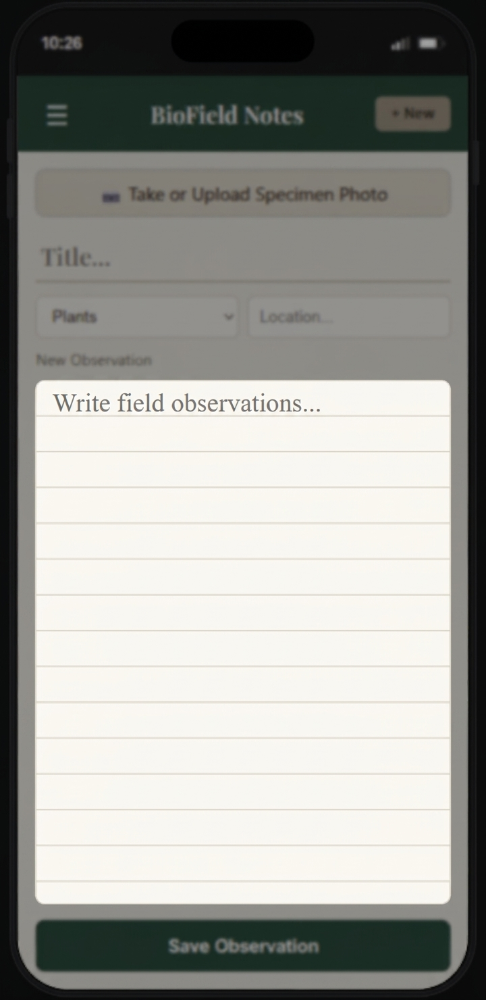 |  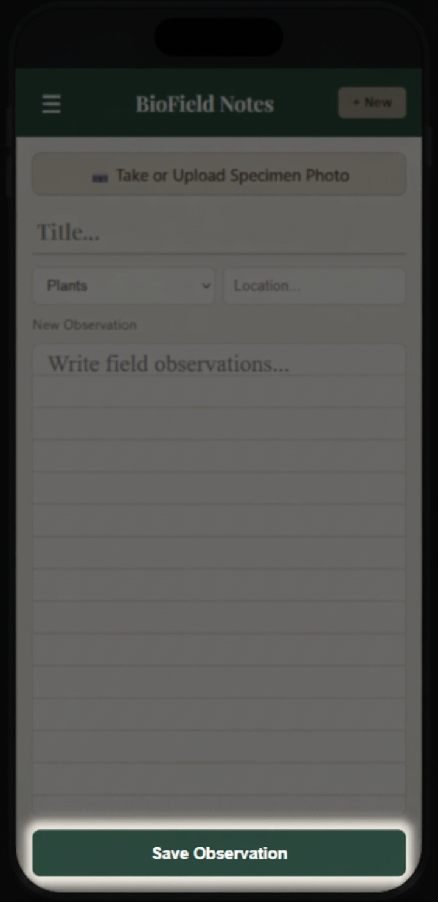 |

## Photo Upload

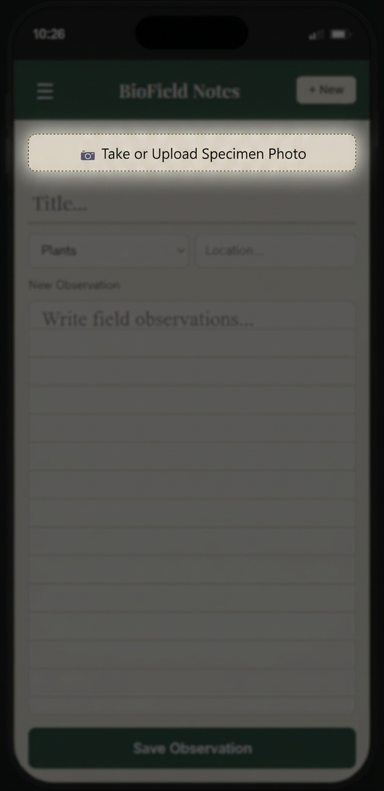

## Notes Management

| Search Notes | Saved Notes | Trash |
| :---: | :---: | :---: | 
| 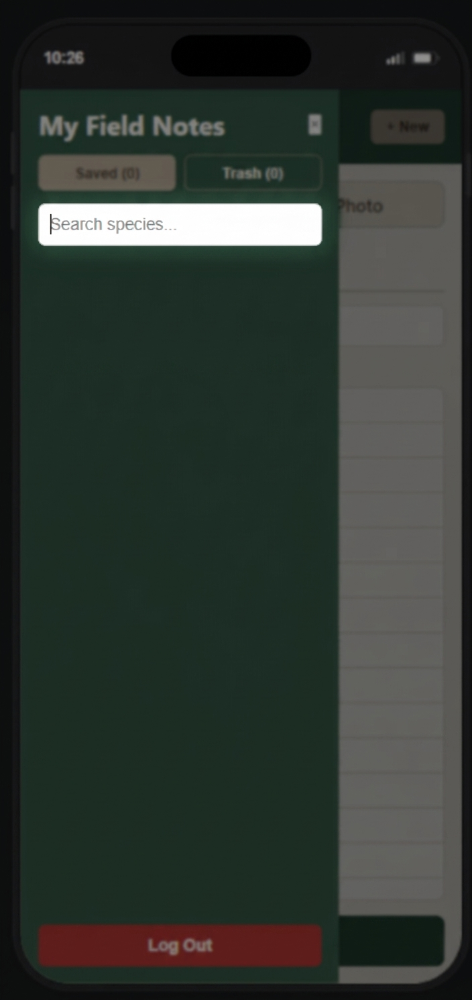 |  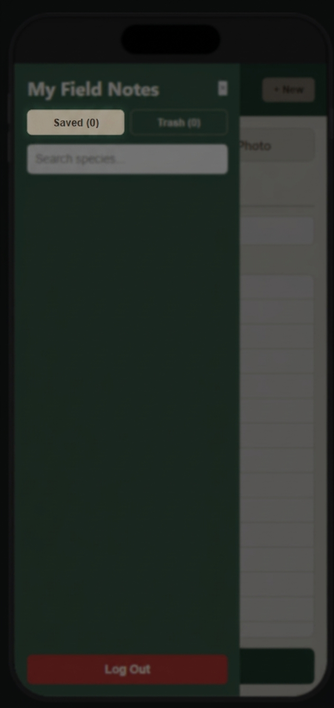 |  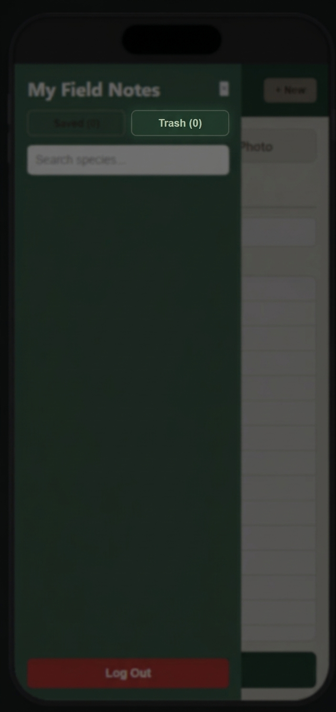 | 

---

## How to Install and Run

### Prerequisites

- A modern web browser, such as Google Chrome or Microsoft Edge.
- Visual Studio Code with the Live Server extension, or Python for running a local server.

### Installation

1. Clone the repository:
git clone [https://github.com/](https://github.com/)<your-username>/<your-repo-name>.git

2. Navigate to the project folder:

cd <your-repo-name>

### Running the Application

**Option 1: Using VS Code Live Server**

1. Open the project folder in Visual Studio Code.
2. Right-click the main HTML file (index.html).
3. Select **Open with Live Server**.

**Option 2: Using Python HTTP Server**

1. Open the project folder in your terminal.
2. Run the command:

python -m http.server 8000

3. Open your browser and visit:

http://localhost:8000

4. Enter a username on the Login Screen to start using **BioField Notes**.

---

## Author Information

- **Name:** Alicia Keith T. Ramos
- **Section:** BSINTE-2c
- **Course / Major:** BS Information Technology, Web and Mobile Application
- **School:** Nueva Vizcaya State University
